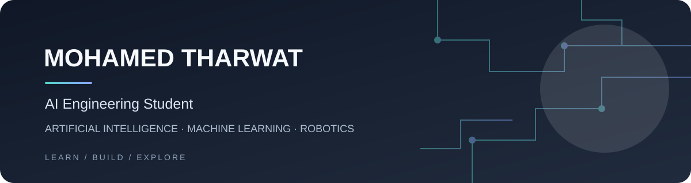

<!-- Profile README for Mohamed-Tharwat-1 -->

  

  <h2>AI Engineering Student | Aspiring AI & Robotics Engineer</h2>

  

    Exploring the intersection of Artificial Intelligence, software development,
    data, and intelligent hardware.
  

  

    <a href="https://github.com/Mohamed-Tharwat-1">GitHub Profile</a>
  

---

## About Me

I'm an engineering student focused on Artificial Intelligence, with a growing interest in building practical systems that connect software intelligence with real-world applications.

- 🎓 AI Engineering student
- 🤖 Interested in Machine Learning, Computer Vision, and Robotics
- 📊 Building skills in Data Analysis and data visualization
- 🔧 Exploring Embedded Systems and hardware–software integration
- 🌱 Learning through hands-on projects and continuous improvement

## Skills & Technologies

**Programming & Data**

**AI & Machine Learning**

**Development & Databases**

## Featured Projects

### Pharmacy Management System
A pharmacy operations system covering medicine inventory, sales, purchases, suppliers, and dashboard workflows. The project direction includes a FastAPI backend, PostgreSQL database, and React frontend.

### FastDelivery — Data Analytics
A delivery analytics project focused on operational performance, delivery delays, delivery time, and customer ratings, with reporting through Power BI.

### Color Memory Challenge
An interactive electronics game concept where players memorize and reproduce a sequence of illuminated colors using LEDs and buttons.

> These are project summaries. Specific implementation status and feature availability may differ by project stage.

## Current Learning Focus

- Python and software engineering fundamentals
- Machine Learning workflows and model evaluation
- Data analysis, SQL, and visualization
- Embedded systems and robotics fundamentals

## Let's Connect

- **GitHub:** [Mohamed-Tharwat-1](https://github.com/Mohamed-Tharwat-1)

---

  Always learning. Always building. Always exploring.

